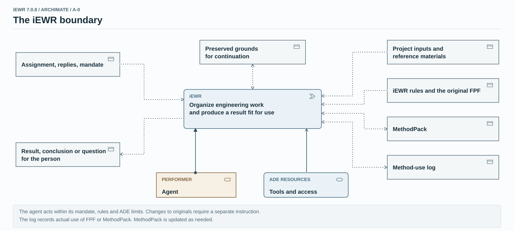
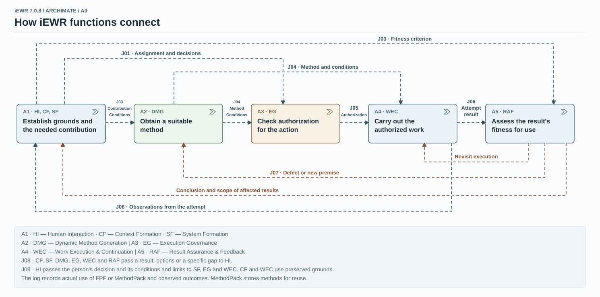
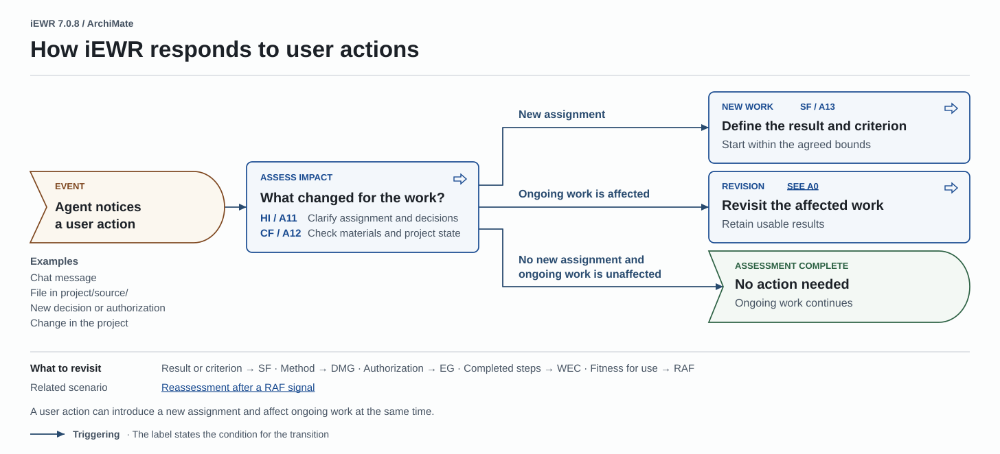
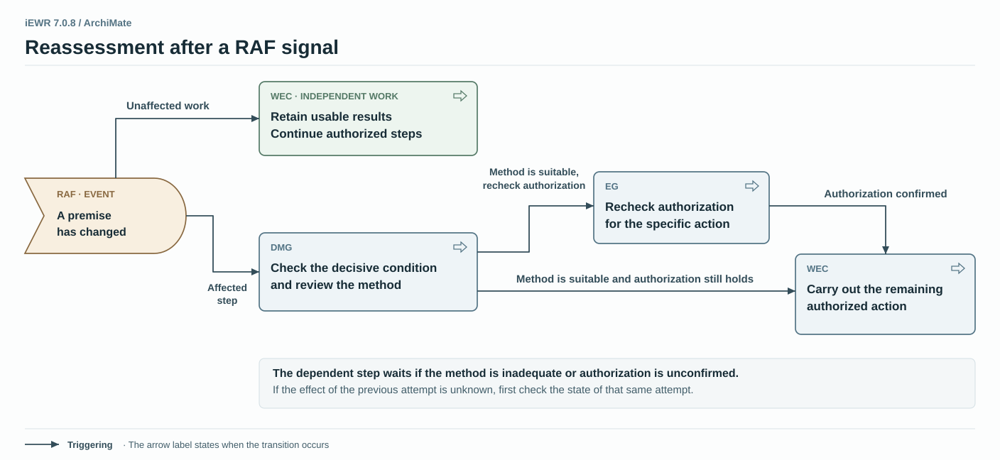

# Functional architecture of iEWR 7.0.8

Two ArchiMate diagrams show the iEWR boundary and the connections between its functions. Two scenarios show how the agent responds to a user action or to a change identified while checking a result.

[Open the full ArchiMate album (PDF, 14 pages, Russian edition)](/ewr/ru/how-iewr-works/architecture/iEWR-7.0.8-ArchiMate-Architecture.pdf)

## A−0 · The iEWR boundary

The person defines the assignment and the bounds of independent action. The agent uses iEWR rules, methods, and project materials. The agent execution environment (ADE) provides tools and access. The agent returns a result, conclusion, or question and preserves the grounds needed to continue the work.

[ Open A−0 at full size](IEWR-7.0.8-METHOD-ARCHIMATE-A-0-r3.svg)

## A0 · How iEWR functions connect

One agent uses seven functions as the task requires. The diagram groups HI, CF, and SF in block A1. RAF receives the fitness criterion. WEC receives the method and the authorization to act separately. If a check finds a defect or a new premise, the agent revisits the affected work.

[ Open A0 at full size](IEWR-7.0.8-METHOD-ARCHIMATE-A0-r5.svg)

## How iEWR responds to user actions

A message, new file, or decision can introduce a new assignment, affect ongoing work, or leave it on track. For a new assignment, the agent defines the result and criterion. If ongoing work is affected, the agent revisits that part and keeps results that still fit. Both conditions can apply at once.

[ Open the user action scenario at full size](IEWR-7.0.8-HUMAN-INPUT-ARCHIMATE.svg)

## Reassessment after a RAF signal

If a check shows that a premise has changed, the agent checks whether the method still fits and rechecks authorization when needed. The affected step waits until the agent has a suitable method and valid authorization. Independent authorized work can continue in the meantime.

[ Open the RAF reassessment scenario at full size](IEWR-7.0.8-RAF-REVIEW-ARCHIMATE.svg)

## Short glossary {#glossary}

- **HI (Human Interaction)** clarifies the assignment and decisions with the person and returns a result or question.
- **CF (Context Formation)** recovers the grounds needed for the next step.
- **SF (System Formation)** determines what contribution the system needs and how to assess the result.
- **DMG (Dynamic Method Generation)** finds, adapts, or constructs a suitable method.
- **EG (Execution Governance)** checks whether a specific action is authorized under the assignment and the conditions for execution.
- **WEC (Work Execution & Continuation)** carries out authorized work, checks its effects, and preserves the grounds for continuation.
- **RAF (Result Assurance & Feedback)** assesses whether the result is fit for use and sends affected work back for reassessment when it finds a defect or a changed premise.
- **ADE** is the agent execution environment. It provides tools and determines access and technical limits.
- **FPF** is the general methodological foundation. **MP (MethodPack)** is the collection of applied methods and adaptations.

## Key notation {#notation}

- A **block with a chevron (Function)** represents a function. A **block with an arrow (Process)** represents work whose order or transition condition matters. A **block with a notch on the left (Event)** represents an event or a state that has been reached.
- A **rectangle (Object)** represents information such as an assignment, project material, or result. In A−0, **Performer (Role)** identifies the agent and **ADE Resources (Service)** identifies the means available to it.
- A **dashed arrow (Flow)** shows the transfer of information or a result. Labels such as `J03` identify architectural connections. Brown marks a return for reassessment.
- A **solid arrow with a filled arrowhead (Triggering)** shows a transition when an event occurs or a condition is met.
- A **dotted arrow (Access)** shows access to an object. An arrow toward the function means read access. An arrow toward the object means write access. Arrows in both directions mean read and write access.
- A **solid arrow with a dot at its start (Assignment)** connects the performer to a function. A **solid arrow with an open arrowhead (Serving)** shows what provides the means to perform a function.

[Open the full ArchiMate album (PDF, 14 pages, Russian edition)](/ewr/ru/how-iewr-works/architecture/iEWR-7.0.8-ArchiMate-Architecture.pdf) · [Return to How iEWR works](../index.md#functional-architecture)
