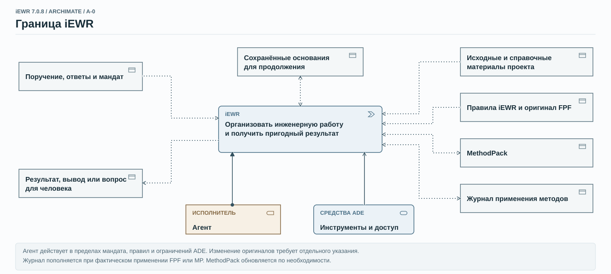
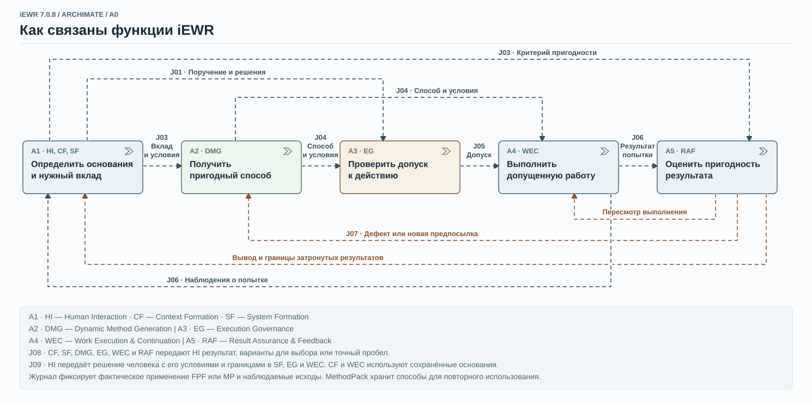
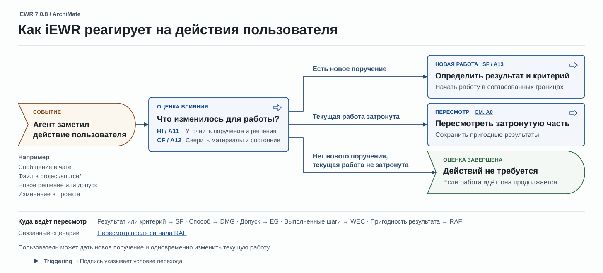
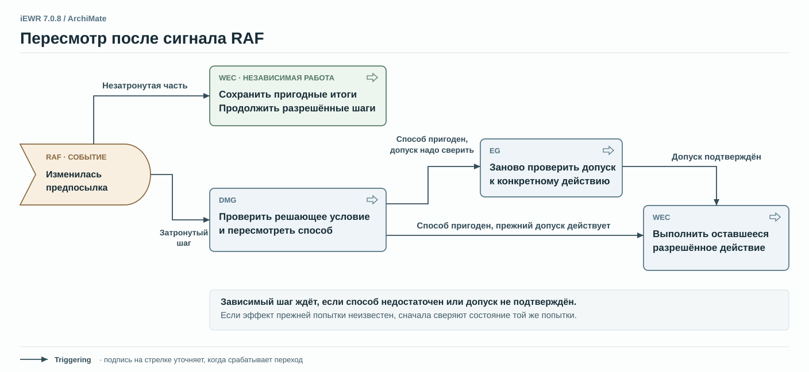

# Функциональная архитектура iEWR 7.0.8

Две схемы ArchiMate показывают границу iEWR и связи между её функциями. Ещё две показывают, как агент реагирует на действия человека и на изменения, выявленные при проверке результата.

[Открыть полный альбом ArchiMate (PDF, 14 страниц)](iEWR-7.0.8-ArchiMate-Architecture.pdf)

## A−0 · Граница iEWR

Человек задаёт поручение и пределы самостоятельных действий. Агент использует правила iEWR, методы и материалы проекта, а агентная среда (ADE) предоставляет инструменты и доступ. Агент передаёт человеку результат, вывод или вопрос и сохраняет основания для продолжения работы.

[ Открыть A−0 в полном размере](IEWR-7.0.8-METHOD-ARCHIMATE-A-0-r3.svg)

## A0 · Как связаны функции iEWR

Один агент задействует семь функций по ситуации. На схеме HI, CF и SF объединены в блок A1. Критерий пригодности поступает в RAF, а в WEC отдельно поступают способ выполнения и допуск к действию. Если проверка выявляет дефект или новую предпосылку, агент пересматривает затронутую часть работы.

[ Открыть A0 в полном размере](IEWR-7.0.8-METHOD-ARCHIMATE-A0-r5.svg)

## Как iEWR реагирует на действия пользователя

Сообщение, новый файл или решение могут дать новое поручение, изменить текущую работу или не повлиять на неё. Если появилось поручение, агент определяет результат и критерий. Если текущая работа затронута, агент пересматривает соответствующую часть и сохраняет пригодные результаты. Оба условия могут выполняться одновременно.

[ Открыть схему реакции на действия пользователя в полном размере](IEWR-7.0.8-HUMAN-INPUT-ARCHIMATE.svg)

## Пересмотр после сигнала RAF

**RAF (Result Assurance & Feedback)** — функция проверки пригодности результата и обратной связи. Если RAF выявляет, что одна из предпосылок изменилась, агент проверяет, подходит ли ещё выбранный способ, и при необходимости заново проверяет допуск к действию. Затронутый шаг ждёт пригодного способа и действующего допуска. Тем временем независимую разрешённую работу можно продолжать.

[ Открыть схему пересмотра после сигнала RAF в полном размере](IEWR-7.0.8-RAF-REVIEW-ARCHIMATE.svg)

## Краткий глоссарий {#glossary}

- **HI (Human Interaction)** — согласовать поручение и решения с человеком, передать результат или вопрос.
- **CF (Context Formation)** — восстановить основания, достаточные для следующего шага.
- **SF (System Formation)** — определить, какой вклад нужен системе и по какому критерию оценить результат.
- **DMG (Dynamic Method Generation)** — подобрать, адаптировать или разработать пригодный способ работы.
- **EG (Execution Governance)** — проверить, допущено ли конкретное действие в рамках поручения и условий исполнения.
- **WEC (Work Execution & Continuation)** — выполнить допущенную работу, проверить её последствия и сохранить основания для продолжения.
- **RAF (Result Assurance & Feedback)** — оценить пригодность результата и вернуть на пересмотр затронутую часть работы, если обнаружен дефект или изменилась предпосылка.
- **ADE** — среда выполнения агента, которая предоставляет инструменты и определяет доступ и технические ограничения.
- **FPF** — общая методическая основа. **MP (MethodPack)** — набор прикладных методов и адаптаций.

## Основные условные обозначения {#notation}

- **Блок с шевроном (Function)** обозначает функцию. **Блок со стрелкой (Process)** показывает действие, для которого важен порядок или условие перехода. **Блок с выемкой слева (Event)** обозначает событие или наступившее состояние.
- **Прямоугольник (Object)** обозначает информационный объект, например поручение, материал или результат. На A−0 блоки **«Исполнитель» (Role)** и **«Средства ADE» (Service)** показывают роль агента и доступные ему средства.
- **Штриховая стрелка (Flow)** показывает передачу сведений или результата. Метки `Jxx` обозначают связи архитектуры, а коричневый цвет выделяет возврат на пересмотр.
- **Сплошная стрелка с заполненным наконечником (Triggering)** показывает переход при наступлении события или выполнении условия.
- **Точечная стрелка (Access)** показывает доступ к объекту. Стрелка к функции означает чтение, к объекту — запись, в обе стороны — чтение и запись.
- **Сплошная стрелка с точкой у начала (Assignment)** связывает исполнителя с функцией. **Сплошная стрелка с открытым наконечником (Serving)** показывает, что предоставляет средства для выполнения функции.

[Открыть полный альбом ArchiMate (PDF, 14 страниц)](iEWR-7.0.8-ArchiMate-Architecture.pdf) · [Вернуться к странице «Как работает iEWR»](../index.md#functional-architecture)
