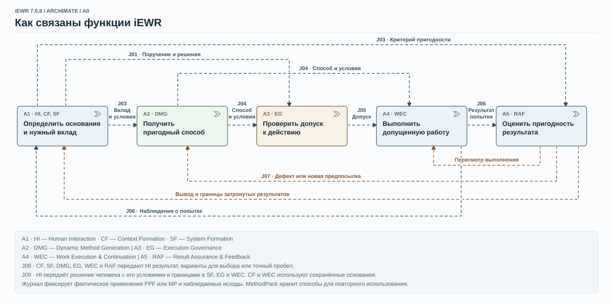

# Как устроена iEWR

**iEWR — агентное приложение на основе AGENTS.md.** Это не отдельная AI-модель и не агентная платформа. Для исполнения используются возможности Codex или другой совместимой агентной среды.

## System Formation — целостное решение задачи {#system-formation}

[Подробнее о System Formation →](/ewr/ru/foundations/system-formation/){ .section-action }

В основе организации работы — **System Formation**: цель, назначение и текущее состояние создаваемой системы определяют необходимую работу. Заранее заданный процесс не подменяет этот выбор. Агент восстанавливает инженерный контекст — действующие требования, решения, связи между частями системы и существенные неизвестные — и использует профессиональные методы и результаты проверок, чтобы определить следующий вклад. Новые сведения могут потребовать другого метода, пересмотра плана или отказа от ставшей ненужной задачи.

## Вклад iEWR в работу Codex {#why-codex-needs-iewr}

[Читать статью «Зачем Codex нужен EWR» →](/ewr/ru/foundations/why-codex-needs-iewr/){ .section-action }

Codex и без iEWR способен планировать, выбирать методы и проверять результаты. iEWR не добавляет ему интеллекта: она закрепляет систематическую организацию инженерной деятельности в инструкциях, методах и проектном контексте. Существующие возможности агента используются и для выполнения работы, и для определения и пересмотра того, какая работа необходима.

Вы задаёте результат, его назначение и границы самостоятельных действий. Агент выполняет необходимую работу и проверяет полученное.

Среда поддерживает разработку и изменение программ, подготовку инженерных концепций и решений, исследования, сравнение вариантов и обоснование выбора. В разделе [«Попробовать iEWR»](/ewr/ru/try/) описаны порядок запуска и начало работы со своей задачей.

## Можно начать с незавершённого замысла

Опишите желаемый результат, пусть приблизительно, или попросите помочь разобраться в проблеме. iEWR поможет уточнить назначение результата и существенные условия работы.

Можно также попросить объяснить её возможности, устройство или следующие шаги. В [Try iEWR](/ewr/ru/try/) — примеры первых сообщений и продолжения работы, в разделе [«Применение»](/ewr/ru/applications/) — более широкий круг задач.

## Ваш вклад и работа агента

Вы определяете намерение, ценность, существенные ограничения и решения, которые оставляете за собой. Вы оцениваете и принимаете результат. Можно совместно обдумывать вопрос с AI или поручить получение результата в согласованных границах.

Агент исследует текущую ситуацию, предлагает или выбирает методы, подготавливает и выполняет работу, проверяет фактические результаты и сохраняет решения и свидетельства для продолжения. Он возвращает вопросы, требующие ваших знаний или неделегированного решения, продолжая независимую разрешённую работу.

Совместное мышление в iEWR называется **S3**, делегированная работа — **S4**. Это способы участия, а не обязательная последовательность этапов.

[Компетенции инженера и лидера →](/ewr/ru/try/advanced/){ .section-action }

## Компоненты среды {#_3}

AGENTS.md служит точкой входа. Приложение 7.0.8 включает инструкции, FPF, MethodPack и средства организации инженерной работы: навигацию, проектные каталоги, проверки и материалы продолжения. Агентная среда предоставляет доступ к файлам, команды, вычисления и другие доступные инструменты.

| Составляющая | Назначение |
|---|---|
| AGENTS.md и связанные инструкции | Связать приложение, текущую задачу, правила работы и источники |
| FPF | Общие понятия, принципы и методы |
| MethodPack | Прикладные методы и накопленная специализация |
| Агентная среда (ADE) | Средства исполнения, доступ и технические границы |
| Проектные файлы | Исходные материалы, решения, результаты, проверки и продолжение |

## Как организуется работа

Архитектура выделяет семь связанных функций:

| Функция | Вклад |
|---|---|
| Context Formation — CF | Восстановить текущую задачу, состояние системы, решения и существенные неизвестные |
| System Formation — SF | Определить нужный системе вклад и критерии его результата |
| Dynamic Method Generation — DMG | Найти, повторно применить, адаптировать или создать подходящий способ работы |
| Execution Governance — EG | Связать действие с поручением, полномочиями и условиями исполнения |
| Work Execution & Continuation — WEC | Выполнить работу, установить последствия и сохранить возможность продолжения |
| Result Assurance & Feedback — RAF | Проверить пригодность и вернуть дефекты на исправление |
| Human Interaction — HI | Получить необходимые человеческие вклады и понятно предъявить результат |

Функции применяются по задаче. Это не семь обязательных стадий или агентов. Пригодные решения, методы и результаты используют повторно. Новые сведения могут менять следующее действие.

## Функциональная архитектурная схема {#functional-architecture}

Схема A0 показывает, как в iEWR 7.0.8 семь функций связывают поручение, выбор способа, выполнение и проверку результата.

[{ width="480" } Открыть полную архитектуру iEWR](architecture/index.md)

## Методы для задачи

При новом выборе метода агент проверяет достаточный вклад FPF, затем необходимую прикладную конкретику MethodPack. DMG восполняет оставшийся пробел адаптацией или созданием. Уже установленные достаточные основания используют повторно.

Поставляемый репертуар — отправная точка. В пределах поручения агент может получать недостающие знания из профессиональных источников, включая интернет средствами доступных инструментов, адаптировать подходящий метод или разработать и проверить недостающее. Не нужно отдельно заказывать каждый новый метод. Полезные вклады сохраняются в MethodPack для следующих задач вместе с условиями и основаниями проверки.

В поставке MethodPack содержит 37 описаний-кандидатов. Их применение определяется назначением, условиями и основаниями проверок. См. [каталог методов](https://github.com/instantiatio/iEWR/blob/7.0.8/docs/METHOD_CATALOG.md) и материал [о FPF, DMG и MethodPack](/ewr/ru/foundations/methods/).

Агент ведёт [журнал применения методов](https://github.com/instantiatio/iEWR/blob/7.0.8/docs/METHOD_USE_LOG.md) в файле `project/artifacts/method-use-log.md`. Обычно на каждое отдельное применение FPF или MethodPack приходится одна строка. По запросу агент добавляет подробную запись.

## Контекст, который продолжается вместе с проектом

Агент организует рабочие материалы и поддерживает основания для продолжения по мере изменения проекта. Вам не нужно конструировать отдельную систему хранения контекста. Исходные материалы размещаются в `project/source/`, результаты и основания проверок — в `project/artifacts/`, материалы продолжения — в `project/handoff/`.

Полезные записи связывают текущее поручение, решения, редакции источников, полученные результаты, проверки, незавершённую работу и следующие вопросы. В новой сессии агент восстанавливает нужное состояние по этим файлам и проверяет его актуальность. Спросите «Как продолжить этот проект?», затем обсудите или поручите следующий вклад.

Проектная папка переносит эти основания между сессиями. В [кейсе GEO CRM](/ewr/ru/cases/geo-crm/) сохранённый контекст поддержал наблюдавшееся продолжение Codex → DeepSeek Harness → Codex и последующую подготовку руководств. Дальнейшие действия определяет текущее поручение; сохранённое предложение само по себе не становится новой задачей.

## Проверка и продолжение

Агент сопоставляет фактический результат с порученным использованием и критериями. Обнаруженная проблема может вернуть работу к требованию, предположению, методу, реализации или проверке. Успешные тесты дают свидетельства о свойствах, которые они наблюдают.

Фактическая конфигурация определяет доступные инструменты и доступ. Инструкции направляют агента; необходимые технические ограничения обеспечиваются ADE и подключёнными системами. В [STATUS 7.0.8](https://github.com/instantiatio/iEWR/blob/7.0.8/STATUS.md) описаны проверки релиза, в [кейсах и экспериментах](/ewr/ru/cases/) — проверенное применение.

[Попробовать iEWR](/ewr/ru/try/) · [Архитектура](https://github.com/instantiatio/iEWR/blob/7.0.8/ARCHITECTURE.json) · [Полный ConOps](https://github.com/instantiatio/iEWR/blob/7.0.8/docs/IEWR_CONOPS.md) · [English](/ewr/eng/how-iewr-works/)
